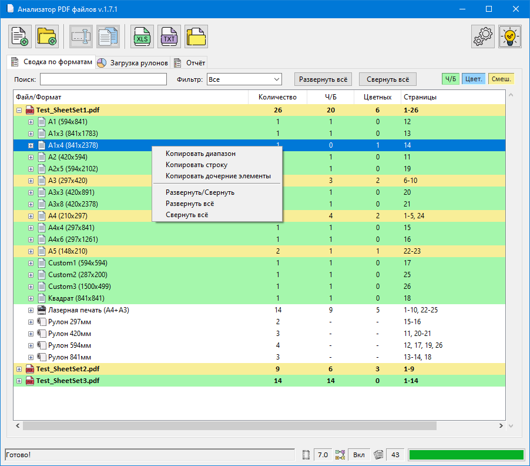

# Backlog

- Совмещенные диапозоны страниц для ч/б и цвета в Excel

# Changelog

Все существенные изменения в этом проекте будут задокументированы в этом файле.

## [1.7.1] - 2026-10-27

- Новый отчет в табличной форме
  - цветовая маркировка
  - раскрывающиеся элементы
  - контекстное меню для копирования диапазонов
  - Поиск и фильтр
- Исправлен механизм определения цветности (Ошибок должно быть меньше)
- Добавлены фильтры в столбцы в Excel отчете
- Исправление группировки по устройствам печати (ранее нестандартные форматы не распределялись по рулонам)
- Повышение UX
- Отчеты (TXT и XLSX) сохраняются только по запросу

## [1.6.6] - 2026-10-22

- EasterEgg's
- Строка с объединёнными форматами A4+A3 в Excel-отчете

## [1.6.0] - 2026-10-19

- Исправление ошибок;
- Повышение UI, некритичные уведомления перенесены в статусную строку;
- Полная переработка дизайна приложения;
- Новые иконки кнопок;
- Добавлена обработка вложенных папок;
- Добавлена drag & drop зона. Можно сбрасывать файлы для обработки прямо на окно.
  
  
  
## [1.5.0] - 2026-09-22

- Исправление ошибок
- Общая сводка по рулонам добавлена в отчет-Excel 
- Создана новая вкладка "📊 Загрузка рулонов" с визуализацией. Две круговые диаграммы:
  - Левая: распределение площади печати (м²) по типам рулонов
  - Правая: распределение длины рулонов (м) по типам

## [1.4.2] - 2026-04-29

- Исправление ошибок
- Обновлен конфигуратор, возможность управлять форматами более удобно

## [1.4.1] - 2026-04-20

- Исправление ошибок
- Оптимизация определения цветности
- Добавлен конфигуратор, как отдельное приложение
- Улучшен прогресс-бар, отображает информацию об прогрессе обрабатываемых файлов в папке
- Добавлен диалог когда возникала ошибка о занятом файле отчета xlsx, теперь можно закрыть отчет или сохранить с другим имен

## [1.4.0] - 2026-04-16

- Разбивка по рулонам
- Кнопки в UI для открытия в Excel отчета и каталога отчетов в проводнике.
- Добавлены кратные форматы которых нет в ГОСТе в конфиг по умолчанию. Для его генерации следует удалить существующий, и сгенерировать новый через настройки.
- Устранен ряд мелких ошибок
- С этой версии exe не собирается в один исполняемый файл, для ускорения запуска. 

## [1.3.0] - 2025-12-30

- Добавлен GUI редактор конфига
- Оптимизация кода.

## [1.2.0] - 2025-12-24

- Добавлен полноценный GUI режим.
- Добавлены кнопки открыть.
- Добавлен текстовый отчет (файл)
- Перенастрока отчета. Добавлена возможность сжимать перечисления файлов с настройкой в config.yaml. (Например: 1,3-10,23)
- Добавлена строка в отчет с объединением форматов А3 и А4
- Контроль загрузки конфига с выводом предупреждений.

## [1.1.0] - 2025-12-19

- Не стандартные форматы больше не смешиваются. Каждому присваивается уникальное имя.
  - Custom1, Custom2 — понятная нумерация.
  - Один размер = один номер (215x302 всегда Custom1)
  - Сводка группируется правильно

## [1.0.0] - 2025-12-17

Первая версия
